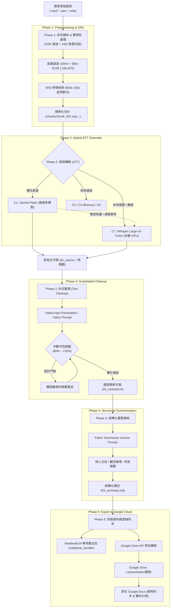

# 🎙️ 大學課堂錄音自動化 ASR 語音辨識與結構化筆記系統 (Lecture Pipeline)

[](https://www.python.org/)
[](https://github.com/astral-sh/uv)
[-FF6F00?style=flat-square)](https://github.com/SYSTRAN/faster-whisper)
[](https://ai.google.dev/)
[](https://developers.google.com/drive)
[](https://notebooklm.google.com/)
[-brightgreen?style=flat-square)](#-測試與品質保證)

一套專為**長達 2~3 小時大學課堂錄音**打造的高效能、高精確度端到端語音辨識（ASR）、AI 內文精修整理與考前結構化重點提煉管線。

系統針對常見學生錄音筆（如 SONY ICD-PX470 桌面平放錄音）所引發的低頻震動、冷氣運轉噪音、遠距殘響以及講師走動音量忽大忽小等聲學痛點進行多段濾波，並結合雲端大模型（Gemini Flash Multimodal Audio）與本地 RTX GPU 算力（Faster-Whisper Large-v3-Turbo / Breeze-ASR），達成**字數 100% 守恆零刪減的標點分段**、**結構化考點總結**，最後自動發布至 **Google Drive 原生 Google Docs**，提供 Google NotebookLM 雙向同步引用。

---

## 📑 目錄

- [✨ 核心亮點](#-核心亮點)
- [🏗️ 系統管線架構 (Pipeline Architecture)](#️-系統管線架構-pipeline-architecture)
- [💻 硬體與系統需求](#-硬體與系統需求)
- [🛠️ 環境建置與快速安裝](#️-環境建置與快速安裝)
- [🔐 API 金鑰與 Google Drive 授權設定](#-api-金鑰與-google-drive-授權設定)
- [🚀 快速上手 (Quick Start)](#-快速上手-quick-start)
- [📖 CLI 完整指令手冊](#-cli-完整指令手冊)
- [🎛️ 設定檔深度指南 (`config.yaml`)](#️-設定檔深度指南-configyaml)
- [📂 專案目錄結構](#-專案目錄結構)
- [🧪 多維實驗評測矩陣 (Benchmark & Matrix)](#-多維實驗評測矩陣-benchmark--matrix)
- [🛡️ 容錯防護與保守 API 策略](#️-容錯防護與保守-api-策略)
- [🧪 測試與品質保證](#-測試與品質保證)
- [📄 授權條款](#-授權條款)

---

## ✨ 核心亮點

1. **專業聲學 DSP 前處理鏈**：
   - 專為講堂錄音環境最佳化：具備 **高通濾波 (80~120Hz)** 消除桌面震動、**EBU R128 (-19LUFS)** 音量正規化、**雙向動態壓縮 (Dynamic Compression)** 拉近講師走動音量差、頻譜降噪、去殘響（WPE）與深度學習神經降噪。
2. **智慧 VAD 靜音切段（Zero Clipping）**：
   - 保守切分 10 分鐘（600 秒）切片，在目標時間點 ±30 秒範圍內智慧搜尋自然講課停頓靜音點（>0.5s, <-40dB），確保絕對不切在音節或單字中間。
3. **雲地混合雙軌 STT 容錯矩陣**：
   - **首選標準通道 C1 (Gemini Flash Audio Verbatim)**：直接聆聽原始切片，語音多模態逐字聽寫，速度快且成本極低。
   - **本地旗艦備援 C7 (Whisper Large-v3-Turbo)**：基於 `faster-whisper` (CTranslate2) 於本機 GPU 高速推論（34 分鐘音檔約 2 分鐘轉錄完畢），不消耗雲端額度。
   - **無縫自動容錯切換**：遇雲端 API 額度耗盡或連線異常時，自動切換本地 C7 備援，管線永不中斷。
4. **字數嚴格守恆的 AI 內文整理（Phase 3 Guardrails）**：
   - 整合開源知名字幕專案 **VideoLingo**（`videolingo_punct.md`）與 **Fabric** 提示詞，專門補全全形標點、梳理段落，並內建長度比例審計護欄（80% ~ 120%），嚴禁 AI 擅自改寫或摘要，做到課堂口語細節零縮減。
5. **結構化考前重點提煉（Phase 4 Exam Notes）**：
   - 自動萃取【課程主旨】、【章節大綱】、【核心概念與中英定義】、【公式與演算法推導步驟】、【講師代表性例題與案例】、【考前關鍵要點與混淆陷阱】，筆記結構嚴謹。
6. **Google Drive API 原生雲端自動發布（規格書第 9 節）**：
   - 自動在使用者雲端硬碟建立 `LectureNotes/<課程名稱>/` 資料夾，並以原子請求上傳並**自動轉為原生 Google Docs**，免去手動匯入的繁瑣，隨時在 Google Docs 編輯或於 NotebookLM 點選「從 Google 雲端硬碟新增」。
7. **Windows 10/11 原生桌面通知 (Desktop Toast Notifications)**：
   - 背景作業狀態全自動推播：音檔開始時「`"{檔名}" 已開始解析`」、同步完成「`"{檔名}" 上傳成功`」、斷網時「`"{檔名}" 處理完成，等候上傳`」、連續故障「`"{檔名}" 損壞，放棄處理`」，訊息清楚透明。
8. **工作列系統匣小圖示 (System Tray Icon)**：
   - 以專案 `icon.png` 靜默常駐系統匣，微型動態徽章即時呈現狀態（閒置💤、處理🔄、上傳⏫、暫停⏸️），滑鼠懸停顯示當前任務與階段進度百分比，右鍵支援「打開 Inbox、暫停/恢復、查看今日紀錄、關閉監控」。
9. **工業級壞檔隔離 (Dead Letter Queue) 與 60 分鐘任務熔斷**：
   - **3 振壞檔隔離法**：同一音檔連續失敗超過 3 次判定為壞檔，自動排除並隔離至 `inbox/failed/`，重置狀態並推播桌面警報，杜絕死迴圈。
   - **60 分鐘任務熔斷器**：單堂課處理上限 60 分鐘，逾時強制熔斷終止並釋放記憶體與運算資源。
10. **自動修剪機制與長期高效封存 (Storage Lifecycle Archiving)**：
    - 處理完成後自動修剪刪除中間龐大產物（`chunks/` 分段切片與未壓縮 `00_normalized.wav`），並透過 FFmpeg 轉碼為高壓縮比語音 Opus/AAC 音檔（體積縮小 90% 以上）。
    - 永久保留四大核心：「高壓縮音檔、完整課堂整理文稿、重點總結筆記、詳細 run.json 維護日誌」，保存於 `C:\Users\LinKJ\Pictures\Record\<課程>\<日期>\`。
11. **純本地 0 API 課堂詞庫自動解析**：
    - 完全無需調用任何雲端 API，0 雲端配額消耗！直接讀取教材投影片 PDF 或講義，透過本機 NLP 與正則高速萃取專有名詞、演算法名稱與中英對照詞，自動匯入 `courses/<課程>/glossary.txt`。
12. **斷網離線排隊與 API 配額次日延期機制**：
    - 斷網時自動降級本地 C7 轉錄，文稿進入 `pending_uploads/` 佇列，復網自動補傳。遇 429 配額用盡時，自動將任務鎖定並延期至隔日（UTC 08:00 / 台灣 16:00 每日重置）執行。

---

## 🏗️ 系統管線架構 (Pipeline Architecture)



---

## 💻 硬體與系統需求

| 元件 | 最低需求 | 推薦配置 (本機模型流暢) | 備註 |
| :--- | :--- | :--- | :--- |
| **作業系統** | Windows 10 / 11 64-bit、Linux、macOS | Windows 11 64-bit | 針對 Windows 路徑編碼進行深度加固 |
| **處理器 (CPU)** | 4 核心以上 (Intel Core i5 / AMD Ryzen 5) | Intel Core i5-12600KF / Ryzen 7 等級以上 | 音訊 DSP 濾波與多執行緒轉檔 |
| **記憶體 (RAM)** | 16 GB RAM | 32 GB RAM | 支援長時課堂音訊無損加載 |
| **顯示卡 (GPU)** | 無（純雲端 C1 模式） | **NVIDIA RTX 3060 / 4060 (8GB VRAM) 以上** | 供 C7/C6/C4 本地 Whisper 推論加速 |
| **系統工具** | **FFmpeg** 4.4+ (須加入環境變數 PATH) | FFmpeg 6.0+ | 音訊解碼、濾波與重採樣核心 |
| **套件管理器** | Python 3.12+、[uv](https://github.com/astral-sh/uv) | `uv` 最新版 | 極速虛擬環境與隔離後端管理 |

---

## 🛠️ 環境建置與快速安裝

本專案使用現代化極速套件工具 `uv` 進行依賴項管理，並對較為龐大的 PyTorch / CUDA 本地推論後端採用環境隔離設計（位於 `backends/fasterwhisper/.venv`），確保主管線乾淨輕量。

### 1. 複製專案庫

```bash
git clone https://github.com/your-username/lecture-pipeline.git
cd lecture-pipeline
```

### 2. 安裝主系統依賴項

```bash
# 安裝主管線所需套件 (含 Typer CLI, Rich, OpenCC, Google GenAI SDK, Google API Client 等)
uv sync
```

### 3. 配置本地 Faster-Whisper 推論後端（可選，使用本地 C7 / C6 / C4 時需要）

本專案將 `faster-whisper` 與 CUDA 依賴隔離於 `backends/fasterwhisper` 目錄下：

```bash
# 建立後端虛擬環境並安裝 GPU 加速套件
uv venv backends/fasterwhisper/.venv --python 3.12
backends/fasterwhisper/.venv/Scripts/pip install faster-whisper nvidia-cublas-cu12 nvidia-cudnn-cu12
```

---

## 🔐 API 金鑰與 Google Drive 授權設定

### 1. 配置 Gemini API 金鑰
複製專案根目錄下的範本並填入有效的 Google Gemini API Key：

```bash
# 建立 .env 檔案
cp .env.example .env
```
在 `.env` 中填入：
```ini
GEMINI_API_KEY="AIzaSyYourGeminiApiKeyHere..."
```

### 2. 配置 Google Drive API 雲端自動發布（OAuth 2.0）
本系統支援將筆記自動上傳並轉為原生 Google Docs。

1. 前往 [Google Cloud Console](https://console.cloud.google.com/)。
2. 建立新專案，至「API 和服務」➜「程式庫」啟用 **Google Drive API**。
3. 前往「OAuth 同意畫面」，選擇「外部」，填入應用程式名稱與您的電子郵件，儲存並新增測試使用者（您的 Google 帳號）。
4. 前往「憑證」➜ 點擊「建立憑證」➜ 選擇「**OAuth 用戶端 ID**」，應用程式類型選擇「**桌面應用程式 (Desktop app)**」。
5. 下載產生的 JSON 憑證，重新命名為 `credentials.json` 並放置於**專案根目錄**。
6. 首次執行上傳時，終端機將顯示授權網址並自動開啟瀏覽器，登入您的帳號完成授權後，系統會自動在本地快取永久有效的 `token.json`（已受 `.gitignore` 保護），日後發布均為全自動靜默執行。

---

---

## 🚀 快速上手 (Quick Start)

系統提供兩種極致便利的操作方式：

### 方案 A：拖曳一鍵執行 (極致直覺、零背景資源消耗) ⭐⭐⭐⭐⭐

本專案支援將**【單個音檔】**、**【多個分段音檔】**或**【包含多檔的整份資料夾】**直接拖曳處理：

1. **一秒建立桌面捷徑與右鍵選單**：
   - 雙擊執行根目錄的 [`建立桌面捷徑與右鍵選單.bat`](file:///c:/Users/LinKJ/Desktop/ASR系統/建立桌面捷徑與右鍵選單.bat)。
   - 即會在 Windows 桌面建立「**課堂錄音一鍵整理**」捷徑，並同步加入檔案總管右鍵「**傳送到 (SendTo)**」選單！
2. **日常使用方式**：
   - **方式一（桌面拖曳）**：直接把錄音檔（或整個錄音資料夾）拖曳到桌面的捷徑圖示上放開。
   - **方式二（右鍵傳送）**：在任何音檔或資料夾上點右鍵 ➜「傳送到」➜「課堂錄音一鍵整理」。
   - **方式三（專案內執行）**：直接將檔案或資料夾拖曳至專案根目錄的 [`一鍵拖曳整理.bat`](file:///c:/Users/LinKJ/Desktop/ASR系統/一鍵拖曳整理.bat) 上。
3. 系統將自動遞迴掃描音訊、依課程智慧分組與排序上下半堂、執行轉錄與總結，並自動建立 Google Docs！

---

### 方案 B：強固型開機自動監看 (放著不管、無感自動化) ⭐⭐⭐⭐⭐

若希望錄音筆一插上、檔案丟進 `inbox/` 就完全不用理會：

1. **一鍵開啟開機自動監控**：
   - 雙擊執行根目錄的 [`開啟開機自動監控.bat`](file:///c:/Users/LinKJ/Desktop/ASR系統/開啟開機自動監控.bat)（或執行命令 `uv run python -m lecture_pipeline.cli autostart enable`）。
   - 系統會在 Windows 開機目錄註冊靜默無感背景啟動腳本（**完全不跳黑色 CMD 視窗**）。
2. **極致穩定性與資源保護機制**：
   - **零遊戲與工作干擾**：背景監看行程自動以 Windows `BELOW_NORMAL_PRIORITY_CLASS`（低優先權）調度，當您在玩 3D 遊戲、編譯程式或進行繁重工作時，系統永遠優先把 CPU 讓給您的前景軟體，絕不掉幀或卡頓。
   - **拷貝防撕裂鎖定 (File Lock)**：雙重驗證檔案大小靜止（3 秒）並嘗試非阻塞獨佔讀寫鎖，確認檔案從錄音筆或隨身碟完全複製完畢才啟動，絕不發生讀取半成品音檔崩潰。
   - **自動歸檔防迴圈**：處理完成後自動將原始錄音移入 `archive/<課程名稱>/<日期>/`，防範重開機重複執行。
   - **隨時一鍵關閉**：雙擊 [`關閉開機自動監控.bat`](file:///c:/Users/LinKJ/Desktop/ASR系統/關閉開機自動監控.bat) 即可完整卸載。

---

### 方案 C：CLI 命終端全手動流程

只需將錄音檔放入 `inbox/`（或任意目錄），執行 `run` 指令：

```bash
uv run python -m lecture_pipeline.cli run "inbox/演算法_20261016.mp3"
```

**您將獲得**：
1. `work/演算法/20261016/` 工作目錄。
2. `00_normalized.wav`：聲學濾波與響度正規化音訊。
3. `chunks/`：VAD 智慧靜音切段後的音訊切片。
4. `01_raw.txt`：保留字字句句與口語細節的原始逐字稿（含時間戳對照檔）。
5. `02_cleaned.txt`：補全標點、段落清晰且 100% 內容守恆的課堂整理文稿。
6. `03_summary.md`：結構化定理、公式、案例與考前強調重點筆記。
7. `notebook_bundle/`：針對 Google NotebookLM 最佳化的檔案組。
8. ☁️ **Google Drive 目錄與 Docs 原生檔案**（直接在終端機輸出瀏覽連結）。

---

## 📖 CLI 完整指令手冊

本系統提供豐富細緻的模組化子指令，可分段執行、調校或批次處理：

| 子指令 | 描述 |
| :--- | :--- |
| `run` | **【一鍵全流程】** 自動依序執行 Phase 1 ➜ Phase 2 ➜ Phase 3 ➜ Phase 4 ➜ Phase 5。 |
| `prep` | **【Phase 1 音訊前處理】** 執行音訊濾波開關鏈與 VAD 靜音切段。 |
| `stt` | **【Phase 2 語音辨識】** 指定辨識通道進行音訊轉錄，產出 `01_raw.txt`。 |
| `clean` | **【Phase 3 內文整理】** 調用 AI 進行錯字校正、標點補全與分段（嚴格字數守恆）。 |
| `summary` | **【Phase 4 重點總結】** 調用 AI 提煉結構化課堂重點筆記（產出 `03_summary.md`）。 |
| `notebook` | **【Phase 5 打包封裝】** 生成 NotebookLM 專用匯入檔案組與鏡像目錄。 |
| `upload` | **【Phase 5 雲端同步】** 將文稿與筆記上傳至 Google Drive 並自動轉成 Google Docs。 |
| `watch` | **【無人值守監看】** 自動監看 `inbox/` 目錄，支援系統匣小圖示、桌面通知、壞檔隔離、60分熔斷與自動修剪。 |
| `extract-glossary` | **【純本地詞庫萃取】** 0 API 消耗，直接從講義/投影片 (PDF/TXT) 提取專業名詞並匯入課程詞庫。 |
| `quota` | **【配額分析報告】** 查看 Google Cloud API 官方額度與本機 RTX 4060 規格對比與最佳化調用策略。 |
| `autostart` | **【開機服務管理】** 啟用 (`enable`)、關閉 (`disable`) 或檢視 (`status`) Windows 開機背景監看。 |
| `bench` | **【多通道評測】** 比對不同通道轉錄成果，計算 CER 與術語召回率，生成 HTML 互動報表。 |
| `matrix` | **【多維測試矩陣】** 將前處理、通道、Prompt 作為操縱變因，產出完整比對資料庫。 |
| `info` | 檢視指定課堂工作目錄的執行階段狀態與切段中繼資料。 |
| `doctor` | **【系統自我診斷中心】** 一鍵全面掃描 GPU、CUDA、FFmpeg、API 金鑰、Google Drive、磁碟與服務健康度。 |

### 指令用法範例

#### 1. 指定本地 GPU 備援通道 (C7) 執行全流程
```bash
uv run python -m lecture_pipeline.cli run "inbox/離散數學 02.wav" --channel C7
```

#### 2. 自訂前處理濾波組合
```bash
# 啟用 120Hz 高通濾波、-16LUFS 響度、輕度動態壓縮
uv run python -m lecture_pipeline.cli prep "inbox/錄音.wav" --pre "hp=120Hz,loud=-16LUFS,dyn=light"
```

#### 3. 獨立執行 AI 內文整理（切換雙通道融合模式）
```bash
uv run python -m lecture_pipeline.cli clean "work/畢業流程說明/20260916" --mode fusion --fusion-file "path/to/whisper_raw.txt"
```

#### 4. 單獨上傳或重新同步至 Google Drive
```bash
uv run python -m lecture_pipeline.cli upload "work/畢業流程說明/20260916"
```

#### 5. 斷點續行（避免重複消耗 API）
預設情況下，`run` 指令會自動偵測已完成的階段並略過；如需強制從頭重新計算，加上 `-f` / `--force`：
```bash
uv run python -m lecture_pipeline.cli run "inbox/.畢業流程說明.mp3" --force
```

#### 6. 純本地 0 API 消耗解析教材並建立課程專用詞庫
```bash
# 從投影片 PDF 解析專有名詞，自動匯入 courses/離散數學/glossary.txt
uv run python -m lecture_pipeline.cli extract-glossary "離散數學" "D:/教材/Discrete_Math_Ch3.pdf"
```

#### 7. 查看雲端官方額度限制 vs 本機 RTX 4060 對比分析
```bash
uv run python -m lecture_pipeline.cli quota
```

---

## 🎛️ 設定檔深度指南 (`config.yaml`)

系統行為可透過根目錄的 [`config.yaml`](file:///c:/Users/LinKJ/Desktop/ASR系統/config.yaml) 進行全域自訂：

```yaml
# 預設前處理開關 (針對 SONY ICD-PX470 桌面錄音最佳化)
preprocessing:
  hp: "100Hz"          # 高通濾波: off | 80Hz | 100Hz | 120Hz (消除桌面震動與冷氣低頻)
  loud: "-19LUFS"      # 響度正規化: off | -16LUFS | -19LUFS | -23LUFS (EBU R128)
  dyn: "off"           # 動態音量平衡: off | light | standard (縮小走動音量差)
  nr: "off"            # 頻譜降噪: off | 6dB | 12dB | 18dB
  dfn: "off"           # DeepFilterNet3 深度降噪: off | on
  se: "off"            # MossFormer2 語音增強: off | on
  wpe: "off"           # 去殘響: off | on
  vadtrim: "off"       # 修剪前端長靜音: off | on

# VAD 與切段設定 (保守穩定策略，切片不切滿上限)
segmentation:
  target_chunk_sec: 600       # 目標切段長度: 600 秒 (10 分鐘)
  search_window_sec: 30       # 靜音搜尋半徑: 在目標時間點 ±30 秒內尋找停頓
  silence_thresh_db: -40      # 靜音判定閾值 (dB)
  min_silence_sec: 0.5        # 最短靜音長度 (秒)
  overlap_sec: 0              # 片段重疊時長

# STT 語音辨識設定
stt:
  default_channel: "C1"              # 預設通道: C1 (Gemini Flash Audio Verbatim)
  fallback_local_channel: "C7"       # 本地自動備援通道: C7 (Whisper Large-v3-Turbo)
  temperature: 0.0
  opencc_config: "s2twp"             # 繁體轉換: s2twp (標準台灣慣用語繁體)

# 內文整理與守恆檢驗設定
cleanup:
  mode: "text"                       # 模式: text (純文字) | audio (邊聽邊修) | fusion (雙通道融合)
  model: "gemini-3.5-flash-lite"
  prompt_template: "videolingo_punct.md"
  chunk_chars: 1500                  # 單次送出字元數 (確保低延遲且絕不摘要)
  length_ratio_min: 0.80             # 最小字數保留比率門檻 (低於此觸發防摘要重試)
  length_ratio_max: 1.20

# 結構化考前重點總結設定
summarize:
  model: "gemini-3.5-flash-lite"
  template: "fabric_summarize_lecture.md"
  thinking_budget: 1024              # 思考預算 Token 數 (Lite 模型自動忽略以維持相容)

# 匯出與 Google 整合設定
export:
  export_dir: "exports"
  auto_open_notebooklm: false
  notebooklm_url: "https://notebooklm.google.com/"
```

---

## 📂 專案目錄結構

```
ASR系統/
├── backends/                         # 隔離之後端推論環境
│   └── fasterwhisper/
│       ├── .venv/                    # 獨立 Python 虛擬環境 (包含 torch/CUDA)
│       └── run_whisper.py            # faster-whisper 獨立推論腳本 (支援二進位 Handle 回退)
├── benchmark/                        # 多通道評測與實驗矩陣報告輸出
│   ├── matrix_report.html            # 互動式評測分析報表
│   └── matrix_results.csv            # 評測指標資料庫
├── courses/                          # 課程專屬詞庫目錄 (可建立 <課程名>/glossary.txt)
│   └── 畢業流程說明/
├── inbox/                            # 待處理音訊檔案放置收件匣 (支援中文檔名)
├── prompts/
│   └── library/                      # 核心提示詞庫
│       ├── videolingo_punct.md       # VideoLingo 高精度台灣課堂標點斷句範本
│       ├── fabric_clean_text.md      # Fabric 課堂內文修復範本
│       ├── fabric_summarize_lecture.md # Fabric 結構化考前重點總結範本
│       ├── audio_grounded_cleanup.md # 邊聽邊修多模態提示詞
│       ├── fusion_cleanup.md         # 雙通道逐字稿融合提示詞
│       └── cornell_notes.md          # 康乃爾筆記範本
├── src/
│   └── lecture_pipeline/             # 主系統原始碼核心
│       ├── bench/                    # CER 計算、測試矩陣與 HTML 報表生成器
│       ├── cleanup/                  # Phase 3 AI 內文整理引擎與守恆檢驗機制
│       ├── export/                   # Phase 5 NotebookLM 打包與 Google Drive API 發布器
│       │   ├── drive_publisher.py    # Google Drive 自動建檔與 Google Docs 轉換核心
│       │   └── notebook_bundle.py    # Notebook 匯出封裝器
│       ├── preprocess/               # Phase 1 模組化音訊 DSP 濾波鏈 (高通/正規化/降噪)
│       ├── stt/                      # Phase 2 雲地語音辨識通道
│       │   ├── c1_gemini_flash.py    # C1: Gemini Flash 逐字轉錄
│       │   ├── c2_gemini_transcribe.py # C2: Gemini Transcribe
│       │   ├── c4_breeze_asr.py      # C4: 聯發科 Breeze-ASR-25
│       │   ├── c6_whisper_large.py   # C6: Whisper Large-v3
│       │   ├── c7_whisper_turbo.py   # C7: Whisper Large-v3-Turbo
│       │   ├── c8_manual_baseline.py # C8: 人工基準對照通道
│       │   └── faster_whisper_base.py# 本地模型跨行程 UTF-8 封裝基底
│       ├── summary/                  # Phase 4 結構化重點總結提煉引擎
│       ├── cli.py                    # 系統 CLI 命令列進入點 (Typer)
│       ├── naming.py                 # 智慧檔名解析與課程路由模組
│       ├── state.py                  # 狀態追蹤與斷點續行 (run.json)
│       └── vad_segment.py            # 智慧 VAD 靜音切段演算法
├── tests/                            # 完整單元測試與端對端回歸測試套件 (71 項測試)
├── config.yaml                       # 系統全域主設定檔
├── credentials.json                  # Google OAuth 2.0 憑證 (使用者提供)
├── token.json                        # Google Drive 存取權杖快取 (自動產生)
├── pyproject.toml                    # 專案相依性配置
└── README.md                         # 專案詳細說明文件
```

---

## 🧪 多維實驗評測矩陣 (Benchmark & Matrix)

為了科學化評估各個變因對辨識率的影響，系統內建多維實驗矩陣引擎（規格書第 3 節）：

### 執行多維實驗評測

```bash
uv run python -m lecture_pipeline.cli matrix "inbox/測試音檔.mp3"
```

實驗引擎會自動將：
- **操縱變因 1**：音訊前處理（`raw`、`hp`、`hp+loud`、`dfn` 等）。
- **操縱變因 2**：STT 語音辨識通道（`C1`、`C7`、`C4`、`C6`）。
- **操縱變因 3**：整理提示詞（`videolingo_punct`、`fabric_clean_text` 等）。

進行交叉笛卡兒積評測，計算 **字元錯誤率 (CER)**、**專有名詞召回率 (Terminology Recall)** 與 **推論耗時**，並在 `benchmark/` 目錄輸出：
1. `matrix_results.csv`：結構化實驗數據表。
2. `matrix_report.html`：包含橫條比對圖、雷達圖與推薦流程指引的互動式報表。

---

## 🛡️ 容錯防護與保守 API 策略

為了防止在處理長時音訊時因大量連續呼叫觸發 Google API 429 速率限制或帳號被暫時阻擋，本系統實裝了業界標準的保守防護機制：

1. **強制時間冷卻間隔 (Rate-limiting Delay)**：
   - Phase 2 STT 音訊切片上傳辨識間隔：**3.0 秒**。
   - Phase 3 內文整理文本區塊間隔：**2.5 秒**。
   - Google Drive 文件建立與轉換間隔：**2.0 秒**。
2. **指數退避重試機制 (Exponential Backoff)**：
   - 當遭遇伺服器尖峰（`503 UNAVAILABLE`）或配額波動時，系統自動暫停 6~8 秒進行最多 3 次階梯式重試。
3. **雲地自動容錯降級 (Graceful Degradation)**：
   - 若雲端 C1 通道遇到無法復原的錯誤或額度完全耗盡，系統會自動在終端機發出警示，並**自動切換至本機 RTX 4060 GPU 執行的 C7 (Whisper Turbo) 繼續運作**。
4. **管線斷點續行 (Smart Resume)**：
   - 每次執行皆將進度即時寫入工作目錄下的 `run.json`。若執行過程中斷，再次啟動時會自動讀取既有檔案（如 `01_raw.txt`、`02_cleaned.txt`），略過已完成之階段，絕不浪費 API 配額。

---

## 🧪 測試與品質保證

本系統包含完善的單元測試與端對端管線測試，涵蓋前處理、命名解析、各大 STT 通道、守恆防線、總結引擎、Google Drive 上傳與本地 Unicode 路徑等。

```bash
# 執行全套測試套件
uv run pytest
```

**測試結果**：
```
============================= 71 passed in 39.30s =============================
```

---

## 📄 授權條款

本專案基於 **MIT License** 授權開源。
提示詞庫部分參考自 [Fabric](https://github.com/danielmiessler/fabric) 與 [VideoLingo](https://github.com/Huanshere/VideoLingo)，其版權分別歸原作者所有。
