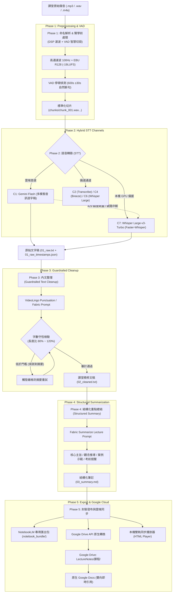

# 🎙️ 大學課堂錄音自動化 ASR 語音辨識與結構化筆記系統 (Lecture Pipeline)

[](https://www.python.org/)
[](https://github.com/astral-sh/uv)
[-FF6F00?style=flat-square)](https://github.com/SYSTRAN/faster-whisper)
[](https://ai.google.dev/)
[](https://developers.google.com/drive)
[](https://notebooklm.google.com/)
[-brightgreen?style=flat-square)](#-測試與品質保證)

一套專為**長達 2~3 小時大學課堂錄音**量身打造的高效能、高精確度端到端語音辨識（ASR）、AI 內文整理與考前結構化重點提煉系統。

針對台灣大學課堂中常見的學生錄音設備（如 SONY ICD-PX470 錄音筆桌面平放或手機錄音）所引發的低頻桌震、冷氣運轉蜂鳴、大講堂遠距殘響、以及講師走動講課導致音量忽大忽小等聲學痛點進行多段濾波；結合雲端多模態模型（Google Gemini Flash）與本地 RTX 顯示卡算力（Faster-Whisper Large-v3-Turbo / MediaTek Breeze-ASR），達成**中英混雜術語高精準辨識**、**字數 100% 守恆嚴禁幻覺摘要的標點分段文稿**、**結構化考點精華總結**；最後自動發布至 **Google Drive 原生 Google Docs**，無縫支援 Google NotebookLM 雙向同步引用與本機獨立雙軌視覺化操作工作台。

---

## 📑 目錄

- [✨ 核心亮點](#-核心亮點)
- [🏗️ 全系統五階段處理管線 (Pipeline Architecture)](#️-全系統五階段處理管線-pipeline-architecture)
- [🖥️ 視覺化雙軌工作台與桌面整合 (GUI & Desktop)](#️-視覺化雙軌工作台與桌面整合-gui--desktop)
- [💻 硬體與系統需求](#-硬體與系統需求)
- [🛠️ 環境建置與快速安裝](#️-環境建置與快速安裝)
- [🔐 API 金鑰與 Google Drive 授權設定](#-api-金鑰與-google-drive-授權設定)
- [🚀 快速上手 (Quick Start)](#-快速上手-quick-start)
- [📖 CLI 完整指令手冊](#-cli-完整指令手冊)
- [🎛️ 設定檔深度指南 (`config.yaml`)](#️-設定檔深度指南-configyaml)
- [📂 專案目錄結構](#-專案目錄結構)
- [🧪 多維實驗評測矩陣 (Benchmark & Matrix)](#-多維實驗評測矩陣-benchmark--matrix)
- [🛡️ 工業級容錯防護、安全沙箱與節流策略](#️-工業級容錯防護安全沙箱與節流策略)
- [🧪 測試與品質保證](#-測試與品質保證)
- [📄 授權條款](#-授權條款)

---

## ✨ 核心亮點

1. **專業聲學 DSP 前處理鏈**：
   - 專為大講堂錄音環境最佳化：具備 **高通濾波 (80~120Hz)** 消除桌面震動、**EBU R128 (-19LUFS)** 音量正規化、**雙向動態平衡 (Dynamic Balance)** 拉近講師走動音量差、頻譜降噪、去殘響（WPE）與神經深度降噪。
2. **智慧 VAD 靜音切段（Zero Clipping）**：
   - 保守切分 10 分鐘（600 秒）切片，在目標時間點 ±30 秒範圍內智慧搜尋自然講課停頓靜音點（>0.5s, <-40dB），確保絕對不切斷單字或語句。
3. **雲地混合雙軌 STT 容錯矩陣**：
   - **首選標準通道 C1 (Gemini Flash Audio Verbatim)**：直接聆聽原始音訊切片，語音多模態逐字聽寫，支援課程詞庫（Glossary）動態注入，速度極快且成本極低。
   - **本地旗艦備援 C7 (Whisper Large-v3-Turbo)**：基於 `faster-whisper` (CTranslate2) 於本機 GPU 高速推論（34 分鐘音檔約 2 分鐘轉錄完畢），不消耗雲端額度。
   - **無縫自動容錯切換**：遇雲端 API 額度耗盡（429）或網路斷線時，自動切換本地 C7 備援，管線永不中斷。
4. **字數嚴格守恆的 AI 內文整理（Phase 3 Guardrails）**：
   - 整合開源字幕專案 **VideoLingo**（`videolingo_punct.md`）與 **Fabric** 提示詞，專門補全全形標點、梳理段落，並內建長度比例審計護欄（80% ~ 120%），嚴禁 AI 擅自改寫或摘要，做到課堂口語細節零縮減。
5. **結構化考前重點提煉（Phase 4 Exam Notes）**：
   - 自動提煉【課程主旨】、【章節大綱】、【核心概念與中英定義】、【公式與演算法推導步驟】、【講師代表性例題與案例】、【考前關鍵要點與混淆陷阱】，筆記結構嚴謹。
6. **Google Drive API 原生雲端自動發布**：
   - 自動在使用者雲端硬碟建立 `LectureNotes/<課程名稱>/` 資料夾，以原子請求上傳並**自動轉為原生 Google Docs**，隨時在 Google Docs 編輯或於 NotebookLM 點選「從 Google 雲端硬碟新增」。
7. **視覺化雙軌工作台 (Dual-Mode GUI) & 系統匣常駐**：
   - 支援 **Windows 原生視窗 (Microsoft Edge WebView2)**、**瀏覽器網頁** 與 **雙軌同時** 三種模式，設定自動記憶。
   - 整合 Windows 系統匣小圖示（System Tray），即時顯示閒置💤、處理🔄、上傳⏫、暫停⏸️ 狀態，支援右鍵選單快速操作。
8. **單一觸發程式模擬封裝 EXE 體驗**：
   - 專案根目錄整合為單一主程式 [`main.py`](file:///c:/Users/LinKJ/Desktop/ASR系統/main.py) 與批次檔 [`啟動系統.bat`](file:///c:/Users/LinKJ/Desktop/ASR系統/啟動系統.bat)。
   - 雙擊直接開啟 GUI + 背景常駐監控 + 系統列小圖示；支援將音檔或資料夾直接拖曳至圖示上進行一鍵整理。
9. **純本機零 API 課堂詞庫自動萃取**：
   - 支援直接拖曳課程講義 PDF/TXT，以純本機正則與統計模型解析專有名詞、縮寫與雙語對照，直接儲存於真實檔案 `courses/<科目>/glossary.txt`。
10. **工業級壞檔隔離、防撕裂複製與任務熔斷**：
    - **防撕裂檔案鎖 (File Lock)**：雙重驗證檔案大小靜止（3 秒）並嘗試獨佔鎖，確認隨身碟或錄音筆檔案完全複製完畢才啟動處理。
    - **3 振壞檔隔離法**：同一音檔連續失敗超過 3 次自動隔離至 `inbox/failed/`，杜絕死迴圈。
    - **安全刪除沙箱**：課堂刪除操作嚴格限定於 `exports/` 目錄，嚴禁刪除原始錄音或長期封存庫。

---

## 🏗️ 全系統五階段處理管線 (Pipeline Architecture)



---

## 🖥️ 視覺化雙軌工作台與桌面整合 (GUI & Desktop)

系統內建現代化暗黑/明亮雙主題視覺化工作台，支援四大多工分頁：

| 工作分頁 | 核心功能說明 |
| :--- | :--- |
| **即時處理台 (Workbench)** | 選擇或拖入音檔、課表自動對齊切換、多階段進度即時可視化（前處理 ➜ STT ➜ 整理 ➜ 總結 ➜ 上傳）、即時暫停任務、強制熔斷中止、今日完成紀錄。 |
| **課堂與播放庫 (Library)** | 關鍵字模糊搜尋、按科目過濾課堂、雙欄同步檢視器（重點筆記與逐字原文）、音訊播放器（1.0x~2.0x 倍速、時間戳跳轉）、一鍵複製筆記包、開啟 Google Docs、本機開啟 Exports、安全刪除歸檔。 |
| **課堂詞庫與課表 (Glossary & Timetable)** | 純本機零 API 講義 PDF/TXT 專有名詞自動萃取、科目新增/刪除、名詞增刪修（即時同步寫入實體檔案）、互動式週課表對齊編輯網格。 |
| **管線參數與目錄 (Settings & Diagnostics)** | 系統目錄變更與本機開啟、前處理音訊參數滑桿調整（高通、LUFS、降噪）、STT 通道切換、單項數值重設、一鍵全方位系統健檢中心（Doctor）。 |

---

## 💻 硬體與系統需求

| 元件 | 最低需求 | 推薦配置 (本機推論流暢) | 備註 |
| :--- | :--- | :--- | :--- |
| **作業系統** | Windows 10 / 11 64-bit | Windows 11 64-bit | 針對 Windows UTF-8、WebView2 與路徑深度最佳化 |
| **處理器 (CPU)** | 4 核心以上 (Intel Core i5 / AMD Ryzen 5) | Intel Core i5-12600KF / Ryzen 7 以上 | 音訊 DSP 濾波、VAD 切割與多執行緒轉檔 |
| **記憶體 (RAM)** | 16 GB RAM | 32 GB RAM | 支援 3 小時超長課堂音訊無損加載 |
| **顯示卡 (GPU)** | 無（純雲端 C1 模式） | **NVIDIA RTX 3060 / 4060 (8GB VRAM) 以上** | 供 C7/C6/C4 本地 Whisper 推論加速 |
| **系統工具** | **FFmpeg** 4.4+ (加入 PATH 環境變數) | FFmpeg 6.0+ | 音訊解碼、濾波與重採樣核心 |
| **套件管理器** | Python 3.12+、[uv](https://github.com/astral-sh/uv) | `uv` 最新版 | 極速虛擬環境與後端隔離管理 |

---

## 🛠️ 環境建置與快速安裝

本專案使用現代化極速套件工具 `uv` 進行依賴項管理，並對 PyTorch / CUDA 本地推論後端採用環境隔離設計（位於 `backends/fasterwhisper/.venv`），確保主環境輕量且啟動極速。

### 1. 複製專案庫
```bash
git clone https://github.com/your-username/ASR系統.git
cd ASR系統
```

### 2. 安裝主系統依賴項
```bash
# 自動建立主虛擬環境並安裝所有依賴（含 FastAPI, PyWebView, Pystray, Google GenAI SDK 等）
uv sync
```

### 3. 配置本地 Faster-Whisper 推論後端（可選，使用本機 C7 備援時需要）
```bash
# 建立隔離後端虛擬環境並安裝 GPU 加速套件
uv venv backends/fasterwhisper/.venv --python 3.12
backends/fasterwhisper/.venv/Scripts/pip install faster-whisper nvidia-cublas-cu12 nvidia-cudnn-cu12
```

---

## 🔐 API 金鑰與 Google Drive 授權設定

### 1. 配置 Gemini API 金鑰
複製專案根目錄下的範本並填入有效的 Google Gemini API Key：
```bash
cp .env.example .env
```
在 `.env` 中設定：
```ini
GEMINI_API_KEY="AIzaSyYourGeminiApiKeyHere..."
```

### 2. 配置 Google Drive API 雲端自動發布（OAuth 2.0）
本系統支援將筆記自動上傳並轉為原生 Google Docs：
1. 前往 [Google Cloud Console](https://console.cloud.google.com/)。
2. 建立新專案，至「API 和服務」➜「程式庫」啟用 **Google Drive API**。
3. 前往「OAuth 同意畫面」，選擇「外部」，填入應用程式名稱與您的電子郵件，新增測試使用者（您的 Google 帳號）。
4. 前往「憑證」➜ 點擊「建立憑證」➜ 選擇「**OAuth 用戶端 ID**」，應用程式類型選擇「**桌面應用程式 (Desktop app)**」。
5. 下載產生的 JSON 憑證，重新命名為 `credentials.json` 並放置於**專案根目錄**。
6. 首次執行上傳時，系統會自動在預設瀏覽器開啟授權視窗，登入後會在本地快取永久有效的 `token.json`（已受 `.gitignore` 保護），日後發布均為全自動靜默執行。

---

## 🚀 快速上手 (Quick Start)

### 方案 A：雙擊單一啟動腳本 (完整模擬 .exe 體驗) ⭐⭐⭐⭐⭐

雙擊專案根目錄的 [`啟動系統.bat`](file:///c:/Users/LinKJ/Desktop/ASR系統/啟動系統.bat)（或執行命令 `uv run python main.py`）：
1. **自動開啟視覺化 GUI**：自動載入上次記憶的模式（原生獨立視窗 / 網頁瀏覽器 / 同時雙開）。
2. **自動啟動背景即時監看**：背景線程自動常駐監控 `inbox/` 收件夾，只要放入錄音檔即刻自動辨識整理。
3. **自動啟動 Windows 系統匣小圖示 (System Tray)**：工作列右下角顯示狀態徽章，支援右鍵選單快速操作。

### 方案 B：拖曳一鍵執行 (Drag & Drop) ⭐⭐⭐⭐⭐

1. **一鍵建立桌面捷徑與右鍵選單**：
   ```bash
   uv run python main.py --setup
   ```
   即會在 Windows 桌面建立「**課堂錄音自動化系統**」專屬捷徑，並同步加入檔案總管右鍵「**傳送到 (SendTo)**」選單！
2. **日常使用方式**：
   - **方式一（桌面拖曳）**：直接把錄音檔（或整個錄音資料夾）拖曳到桌面的捷徑圖示上放開。
   - **方式二（右鍵傳送）**：在任何音檔或資料夾上點右鍵 ➜「傳送到」➜「課堂錄音自動整理」。
   - **方式三（專案內執行）**：直接將檔案或資料夾拖曳至專案根目錄的 [`啟動系統.bat`](file:///c:/Users/LinKJ/Desktop/ASR系統/啟動系統.bat) 上。
3. 系統將自動掃描音檔、智慧分組上下半堂、執行轉錄與整理，並自動發布 Google Docs！

### 方案 C：CLI 命終端全手動流程
```bash
uv run python main.py run "inbox/演算法_20261016.mp3"
```
**處理產物**：
- `01_raw.txt`：字字保留口語細節的原始逐字稿（含時間戳記對照檔）。
- `02_cleaned.txt`：標點分段清晰且字數 100% 守恆的課堂整理文稿。
- `03_summary.md`：結構化定理、公式、案例與考前強調重點筆記。
- `notebook_bundle/`：針對 Google NotebookLM 最佳化的檔案組。
- ☁️ **Google Drive 目錄與 Docs 原生檔案**（終端機與 GUI 直接輸出瀏覽連結）。

---

## 📖 CLI 完整指令手冊

| 指令 | 說明 | 常用參數 |
| :--- | :--- | :--- |
| `main.py` | 預設無參數執行：同時啟動 GUI、背景監控與系統匣圖示 | `--mode window\|web\|both` |
| `main.py --setup` | 自動在 Windows 桌面與右鍵 SendTo 建立系統捷徑 | `-s` |
| `main.py run <files...>` | 【一鍵全流程】依序執行 Phase 1 ~ Phase 5 全管線 | `-c C1\|C7`, `--upload/--no-upload` |
| `main.py prep <files...>` | 執行 Phase 1：檔名解析、DSP 聲學濾波與 VAD 靜音切段 | `-p hp,loud`, `-t 600` |
| `main.py stt <work_dir>` | 執行 Phase 2：調用 STT 辨識通道產出原始逐字稿與時間戳 | `-c C1`, `--style verbatim` |
| `main.py clean <work_dir>` | 執行 Phase 3：調用 AI 進行內文整理、補標點與字數守恆審計 | `-m text\|audio\|fusion` |
| `main.py summarize <dir>` | 執行 Phase 4：提煉結構化重點筆記與心智思維脈絡 | `-t fabric_summarize_lecture.md` |
| `main.py bundle <dir>` | 執行 Phase 5：打包 NotebookLM 專用檔案組並匯出至 Exports | `--open-browser` |
| `main.py upload <dir>` | 建立 Google Drive 課程資料夾並自動轉換為原生 Google Docs | `--no-browser` |
| `main.py watch` | 啟動資料夾無人值守監看服務（含檔案鎖、壞檔隔離、系統匣） | `-i inbox`, `--channel C1` |
| `main.py doctor` | 【系統健檢診斷中心】一鍵掃描 GPU、CUDA、FFmpeg、API 金鑰與磁碟 | 無 |
| `main.py autostart` | 管理 Windows 開機無感自動背景監看服務 | `enable`, `disable`, `status` |
| `main.py extract-glossary` | 純本機零 API 解析講義/投影片，自動提取專有名詞與縮寫 | `<course> <file_or_dir>` |
| `main.py bench` | 執行多通道 STT 評測，計算 CER、術語召回率並產出 HTML 報表 | `-c C1,C7`, `-a <audio>` |
| `main.py matrix` | 多維測試矩陣：前處理開關、STT 通道、提示詞模板交叉實驗 | `-i <audio_file>` |

---

## 🎛️ 設定檔深度指南 (`config.yaml`)

```yaml
# 系統路徑設定
paths:
  inbox_dir: "inbox"
  work_dir: "work"
  archive_dir: "archive"
  record_archive_dir: "C:\\Users\\LinKJ\\Pictures\\Record"
  logs_dir: "logs"
  benchmark_dir: "benchmark"
  prompts_dir: "prompts"
  courses_dir: "courses"

# 預設聲學前處理開關
preprocessing:
  hp: "100Hz"          # 高通濾波: off | 80Hz | 100Hz | 120Hz (消除桌面震動)
  loud: "-19LUFS"      # 響度正規化: off | -16LUFS | -19LUFS | -23LUFS (EBU R128)
  dyn: "off"           # 動態平衡: off | light | standard (拉近走動音量差)
  nr: "off"            # 頻譜降噪: off | 6dB | 12dB | 18dB
  dfn: "off"           # DeepFilterNet3 深度降噪: off | on
  se: "off"            # MossFormer2 語音增強: off | on
  wpe: "off"           # WPE 去殘響: off | on
  vadtrim: "off"       # 前端長靜音修剪: off | on

# VAD 靜音切段設定 (保守穩定策略)
segmentation:
  target_chunk_sec: 600       # 目標切段時長 (秒): 10 分鐘
  search_window_sec: 30       # 靜音搜尋半徑 (秒): ±30s 內尋找講課停頓
  silence_thresh_db: -40      # 靜音閾值 (dB)
  min_silence_sec: 0.5        # 最短靜音長度 (秒)
  overlap_sec: 0              # 重疊時長 (0 為自然斷點切割)

# STT 語音辨識通道
stt:
  default_channel: "C1"             # 預設通道: C1 (Gemini Flash Audio Verbatim)
  fallback_local_channel: "C7"      # 本地備援通道: C7 (Whisper Large-v3-Turbo)
  prompt_style: "verbatim"          # 提示風格: verbatim (字字逐字) | polite_clean
  temperature: 0.0                  # 隨機度
  opencc_config: "s2twp"            # 簡轉繁: 台灣慣用語標準繁體 (s2twp)

# 內文整理與字數守恆護欄
cleanup:
  mode: "text"
  model: "gemini-3.5-flash-lite"
  prompt_template: "videolingo_punct.md"
  chunk_chars: 1500                 # 分段字元長度
  overlap_chars: 300                # 重疊上下文
  length_ratio_min: 0.80            # 最低長度比 (防範 AI 摘要)
  length_ratio_max: 1.20            # 最高長度比 (防範 AI 幻覺灌水)

# 重點總結設定
summarize:
  model: "gemini-3.5-flash-lite"
  template: "fabric_summarize_lecture.md"
  thinking_budget: 1024

# 匯出與 Google 雲端整合
export:
  export_dir: "exports"
  auto_open_notebooklm: false
  notebooklm_url: "https://notebooklm.google.com/"

# 視覺化 GUI 偏好記憶
gui:
  mode: "window"                    # 記憶模式: window | web | both
  host: "127.0.0.1"
  port: 8000
  window_width: 1280
  window_height: 800
```

---

## 📂 專案目錄結構

```text
ASR系統/
├── main.py                        # 【單一整合主程式】模擬封裝 EXE 功能 (GUI + 背景監控 + 小圖示)
├── 啟動系統.bat                   # 【單一觸發腳本】雙擊啟動或拖曳音檔一鍵整理
├── config.yaml                    # 全域管線設定檔 (聲學前處理、STT 通道、課表、GUI 記憶)
├── pyproject.toml                 # 專案套件配置 (相容 uv 與 hatchling)
├── icon.png                       # 系統應用圖標與系統匣狀態基底圖
├── .env.example                   # API 金鑰範本
├── credentials.json               # (使用者配置) Google Drive API OAuth 客戶端憑證
├── token.json                     # (自動快取) Google Drive API 授權權杖
├── courses/                       # 課程詞庫目錄 (真實實體檔案儲存)
│   ├── Creative Invention/        # 範例科目：創意發明 (包含 glossary.txt)
│   ├── Discrete Mathematics/      # 範例科目：離散數學
│   └── Engineering Mathematics/   # 範例科目：工程數學
├── inbox/                         # 自動監控收件夾 (放著不管，丟入音檔即刻自動處理)
├── work/                          # 執行期工作目錄 (存放暫存切片、逐字稿與中間產物)
├── exports/                       # 課堂筆記產物匯出目錄 (供播放庫與本機檔案檢視)
├── archive/                       # 原始錄音短期自動封存目錄
├── logs/                          # 背景服務與系統執行日誌
├── backends/                      # 本地推論隔離環境
│   └── fasterwhisper/             # CTranslate2 / Faster-Whisper 獨立 Python 3.12 虛擬環境
├── prompts/library/               # AI 提示詞庫 (含 VideoLingo 標點、Fabric 課堂整理與總結)
├── src/lecture_pipeline/          # 系統核心原始碼
│   ├── cli.py                     # Typer 命令列介面模組
│   ├── drag_and_drop.py           # 拖曳一鍵批次處理引擎
│   ├── naming.py                  # 檔名解析與課程日期識別
│   ├── state.py                   # 狀態持久化與課表自動對齊演算法
│   ├── vad_segment.py             # 智慧 VAD 靜音切段
│   ├── glossary.py                # 純本機零 API 講義術語萃取器
│   ├── preprocess/                # 聲學 DSP 濾波鏈 (高通、LUFS、動態平衡、降噪)
│   ├── stt/                       # STT 多通道轉錄 (C1, C2, C4, C6, C7, C8)
│   ├── cleanup/                   # Phase 3 字數守恆內文整理引擎
│   ├── summary/                   # Phase 4 結構化考點總結引擎
│   ├── export/                    # Phase 5 Google Drive 發布與 HTML 播放器
│   ├── automation/                # 背景監控 (Watchdog)、系統匣 (Pystray)、開機自啟
│   └── gui/                       # 視覺化工作台 (FastAPI 後端、WebView2 視窗、前端頁面)
└── tests/                         # 自動化測試套件 (涵蓋單元測試、整合測試與 Chrome E2E 測試)
```

---

## 🧪 多維實驗評測矩陣 (Benchmark & Matrix)

系統內建科學化評測引擎，支援對不同前處理組合、提示風格與 STT 通道進行標準化測試，並自動計算字詞錯誤率（CER）與專有名詞召回率：

- **啟動標準評測**：
  ```bash
  uv run python main.py bench -a "benchmark/clips/Discrete Mathematics 13.mp3" -c C1,C7
  ```
- **產出成果**：自動產出互動式 HTML 視覺化報表（`benchmark/report.html`）與 CSV 數據分析表，清楚呈現各通道辨識耗時、CER 指標與詞條比對詳情。

---

## 🛡️ 工業級容錯防護、安全沙箱與節流策略

1. **Exports 筆記安全刪除沙箱**：
   - 在 [`bridge.py`](file:///c:/Users/LinKJ/Desktop/ASR系統/src/lecture_pipeline/gui/bridge.py) 中強制加入路徑沙箱驗證：所有 GUI 課堂刪除操作嚴格限定在 `exports/` 目錄內，**絕對阻擋並拒絕刪除任何原始錄音庫或長期封存目錄**。
2. **API 呼叫防 429 節流延遲**：
   - 內建智慧呼叫冷卻機制，在長時分段調用 Gemini API 時自動加入微延遲，徹底杜絕觸發 Google Cloud 429 Resource Exhausted 限制。
3. **低優先權背景執行 (Zero Lag)**：
   - 背景監看行程自動以 Windows `BELOW_NORMAL_PRIORITY_CLASS`（低優先權）調度，當您在玩 3D 遊戲、編譯程式或進行繁重工作時，系統永遠把 CPU/GPU 優先讓給前景軟體，絕不造成任何卡頓。
4. **全端 UTF-8 強制編碼加固**：
   - Windows 環境下全數強制以 UTF-8 重新配置標準輸入/輸出與所有檔案讀寫，徹底消除中文亂碼與路徑解析例外。

---

## 🧪 測試與品質保證

專案包含完整的自動化測試套件，涵蓋前處理、VAD、各 STT 通道、整理審計、Google Drive 發布、GUI 後端、以及 Google Chrome 瀏覽器端對端（E2E）自動化點擊測試：

```bash
# 執行全套自動化測試
uv run pytest
```

- **測試通過統計**：`103 passed, 1 warning`（100% 通過）。
- **E2E 覆蓋率**：全面涵蓋 133 個 DOM 按鈕互動、11 次對話框全流程模擬，瀏覽器主控台 0 JavaScript 異常。

---

## 📄 授權條款

本專案採用 [MIT License](file:///c:/Users/LinKJ/Desktop/ASR系統/LICENSE) 授權條款開源發布。
